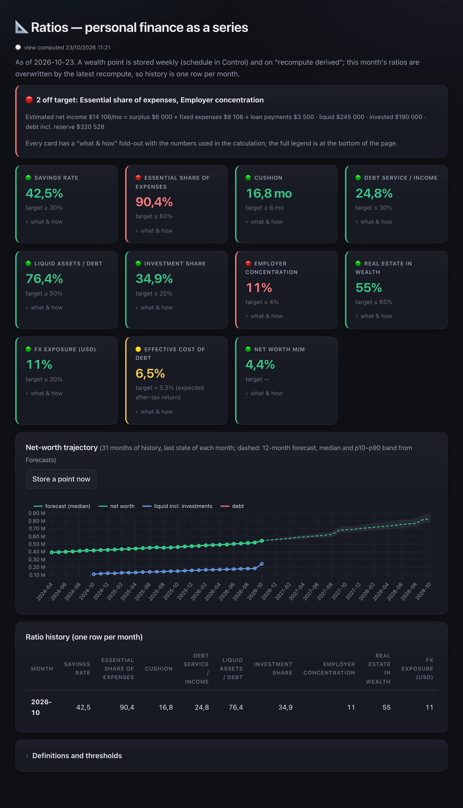
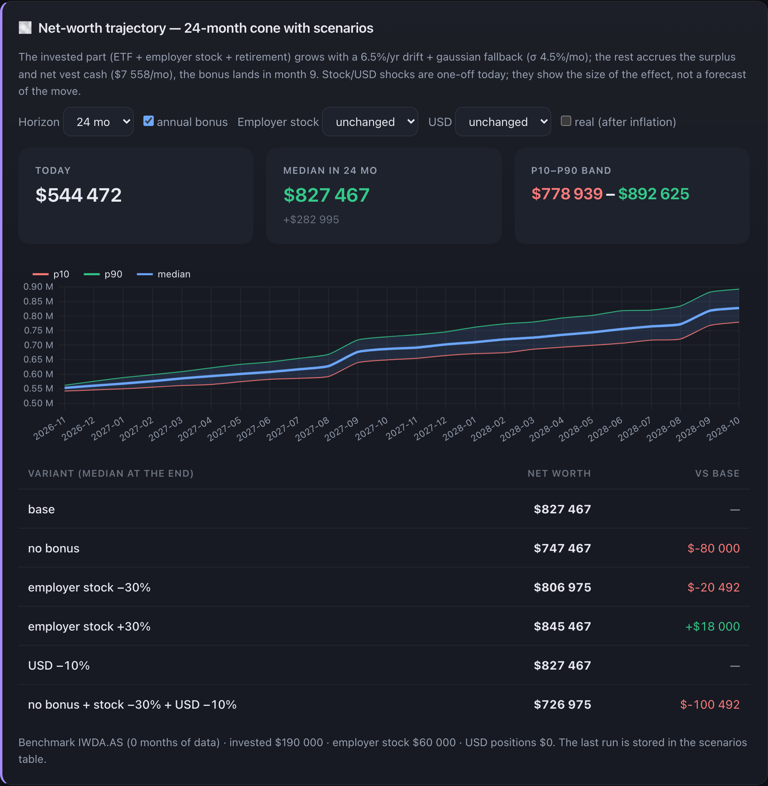
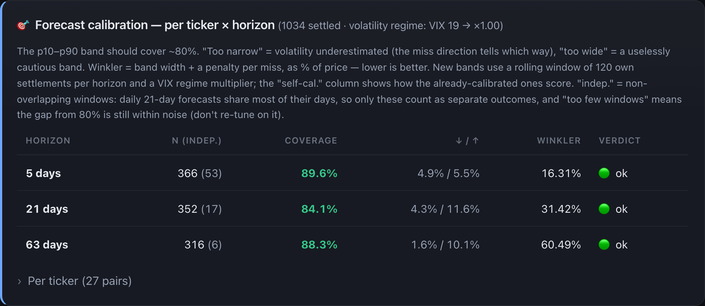

# 💎 Kist Finance — Local-First Private AI Money Hub Web App

  

---

Kist-finance is a local-first personal finance hub that brings your scattered money picture into a single, private command center. It pairs a self-hosted dashboard for net worth, cash-flow, goals, and forecasting with a built-in AI that runs entirely on your own machine, so your numbers never leave it. Every figure lives in one local database you control, with optional integrations that touch only public market data. It's the calm, opinionated cockpit for people who would rather own their data than rent access to it.

## Features

- **One dashboard, every number that matters** — net worth, cash-flow, debts, goals, investments, taxes and career signals come together in a single decision cockpit, so you stop hopping between ten apps and a spreadsheet you keep forgetting to update.

- **Projections that answer "when," not just "how much"** — month-by-month goal ETAs, FIRE/work-optional crossover points, and overpay-vs-invest scenarios with the saved-interest math already done for you.

- **Opinionated, data-grounded guidance** — an FX signal engine with a historical backtest, RSU Monte-Carlo run on real volatility, debt-overpayment simulations, and sell-vs-hold reasoning that shows its work instead of guessing.

- **Forecasts that admit what they don't know** — short-horizon range forecasts and labeled long-horizon scenario bands, built on research-grounded modeling. The forecast journal grades its own coverage daily against an 80% target and self-calibrates on its own past errors, so every band comes with a one-sentence explanation.

- **A calm read on a nervous world** — the 🌍 Risk Radar blends VIX, gold, oil and USD into one clear calm / elevated / hot reading, backfilled a month and refreshed daily. Context, not prediction.

- **Local-first by design** — everything lives in one SQLite file stored outside the repo by default. No database server, no cloud account, no personal data shipped in the repo. A first-run wizard sets you up, and demo mode masks every figure so screenshots stay safe.

- **Private AI that runs on your machine** — a built-in local LLM reviews your recommendations, narrates forecasts, and answers questions grounded in your own numbers, with retrieval over your real data. AI is a core feature but never a requirement: with no model running, every AI surface degrades gracefully to "offline" and the rest of the app carries on. A cloud second opinion exists only behind an explicit, off-by-default switch.

- **Modules that fit your life** — enable only what you need and the rest disappear from the UI: Loans, Taxes, Market & FX, Equity / RSU, Business, Career, and Property analysis sit alongside the always-on core of Dashboard, Cash-flow, Recommendations, Wealth, Fixed Expenses, Allocation, Goals, Forecasts, Ratios and the Control Center.

- **A Control Center that keeps you honest** — status, backups, security review, data inventory and reminders in one place, with every scheduled task's last failure visible and a one-click restart when the running server drifts from the code on disk. The AI improvement tab holds modes, the ask box, the prompt log with 👍/👎, learned lessons and a research-backed roadmap — everything AI in one auditable spot.

- **Connected where you want it, offline where you don't** — optional integrations touch only public market data, never your numbers. Without them, the app is fully functional offline.

## Screenshots

Every view below is captured from the built-in demo persona, with all figures masked — the same safe-screenshot mode you get on first run. Expect a calm, information-dense cockpit rather than a wall of charts.

**Dashboard** — net worth, cash-flow and the day's headline numbers on a single card-based landing view.

**Ratios** — eleven personal-finance ratios with traffic lights against their targets, paired with a net-worth trajectory and a month-by-month history strip.

**Forecasts** — a 24-month net-worth cone (p10 / median / p90) with scenario toggles for bonus, employer stock, currency and real terms, plus the goal-ETA and FIRE crossover readouts underneath.

**Forecast calibration** — how often the p10–p90 band actually covered the outcome, broken down per horizon, with a per-ticker coverage view that flags thin samples instead of crying wolf.

**Market & Risk Radar** — watchlist analytics next to a single calm / elevated / hot reading blended from volatility, gold, oil and the dollar.

**Recommendations** — rule-engine guidance with an outcome trail: when each item opened, whether it was done, rejected or superseded, and the monthly execution rate.

**Control Center** — status, backups, the security review and the AI improvement tab: local model health, the prompt log, learned lessons and the learning-loop checklist.

Screenshots are regenerated straight from a throwaway demo database, so they always reflect the shipping UI rather than a stale mockup.

## Getting Started

Everything you need is already on your machine — no accounts, no cloud sync, no data pipeline to babysit. The moment the app opens for the first time, a guided setup walks you through the three choices that matter: which modules fit your life, where your numbers come from, and which optional integrations (if any) you want to switch on.

Start by enabling only the modules that match how you actually manage money. Core views like Dashboard, Cash-flow, Wealth, and Forecasts are always present; everything else — Loans, Taxes, Market & FX, Equity / RSU, Business, Career, Property analysis — appears the moment you flip it on and disappears cleanly if you turn it back off. You can revisit that choice any time, so there's no penalty for starting lean.

Then decide how your data begins. Three paths, all equally at home:

- **Explore with a sample persona** — load a fully populated demo profile to click through every tab before entering a single real figure. Perfect for a first look, and safe to discard afterward.
- **Start empty and make it yours** — begin with a clean slate and type in your own accounts, goals, and recurring costs at your own pace. The interface is built to fill in gradually rather than demand a spreadsheet migration up front.
- **Hand the setup to an AI assistant** — an optional copyable onboarding prompt lets any assistant interview you and populate the app tab by tab. It's the fastest route to a fully shaped dashboard, with a clear reminder that a cloud assistant takes your answers off your machine — pair it with the built-in private AI if that matters to you.

Integrations are entirely optional. Skip them and kist-finance remains fully functional offline; add them later whenever you want live context layered on top. Everything stays local by default, stored in a single SQLite file outside the project folder, so your first session ends the same way every later one does: with your data in your own hands.

## 📸 Screenshot

## Built-in Private AI

Private AI is a first-class part of kist-finance, not an add-on bolted to the side. The app ships its entire local AI stack — client, grounding, retrieval, prompt log, safety checks — and is engineered so that **your numbers never leave your machine**. The only piece it cannot bundle is the model weights themselves, so you point it at a local model once and every AI feature lights up. No model running? Each AI surface degrades gracefully to "offline" and the rest of the app carries on untouched.

**How the local model works.** Run a small open model with an OpenAI-compatible local server; the app talks to it over localhost with no API keys, no per-call cost, and zero data egress. Where a response must be machine-readable, kist-finance sends a strict schema that the server enforces at the token level, so structured output always parses. For heavier analysis it toggles a model's reasoning mode on; for quick structured calls it turns it off. Control Center surfaces the model's live status, and the security review actively probes the local server to confirm it rejects keyless requests — the off switch is real, and it is verified.

**What the AI actually does inside the app.**

- **A second opinion on every recommendation** — the rule engine does the math from your data; the AI reviews each recommendation, agrees or disagrees, and flags what's missing, grounded in your own figures.
- **Forecast narration** — turns the self-learning forecast journal into a plain-language *why*, so every band and projection comes with a human explanation.
- **A grounded ask-anything box** — pose a question in natural language and get an answer built from your actual numbers, not generic advice.
- **Read-only access to your real data** — the model gets exactly one tool: a single read-only query against your local database. Ask how far you are from a goal and it reads the actual tables instead of guessing from text. Defense in depth is built in: the connection is opened read-only at the database level, only one statement passes validation, results are capped, and every round-trip lands in the prompt log — while the security review pentests that guard against injection and stacked-query payloads on every pass.

**AI mode — local by default, cloud strictly opt-in.** A single switch governs every AI call. The default keeps everything on your machine: local only, full stop. Flip to a two-engine mode and the app consults both a local model and an optional cloud model, then synthesizes one verdict from the two answers — with a plain warning that this sends prompt snippets off your machine, and your own key required to enable it. Every AI answer is framed by a financial-analyst system prompt (explicit assumptions, scenario ranges, opportunity cost and tax, a one-line bottom line), and every question and answer is recorded in a local prompt log so you can see exactly what was asked and whether the AI helps.

**Retrieval grounded in your own numbers.** Before the AI answers, kist-finance hands it the matching snippets of *your* data — goals, wealth items, offers, business entries, saved analyses, plus computed recommendations and reminders — from a fully local index with no vector database and no external service. The index maintains itself: any data write marks it stale and it reindexes before the next answer, with a manual refresh always available. Retrieval starts lexical and upgrades to a hybrid lexical-plus-semantic stage if you point it at a local embedding server, so a question can match by meaning even across different words or languages. Add an optional reranker and a small cross-encoder reorders the candidates by true relevance before the top few reach the model. Every stage follows the same graceful contract — present, it sharpens the answer; absent, the app quietly falls back and keeps working.

**It learns from its good answers.** When a response is genuinely useful, one click distills that exchange into a single transferable lesson — the method and the pitfall, not your specifics — which the assistant draws on in future answers. Over time the AI gets more useful without ever sending your data anywhere it shouldn't go.

## License

`kist-finance` is released under the **MIT License** — a short, permissive license that lets you use, copy, modify, merge, publish, distribute, sublicense, and sell copies of the software, provided the copyright notice and permission notice travel with it. In plain terms: take it, run it, adapt it to your own finances, fork it for your team, or build on top of it. The only obligations are keeping the license text intact and understanding that the software is provided **"as is"**, without warranty of any kind — no guarantee of correctness, fitness for a particular purpose, or that a forecast will come true. It's a decision aid, not financial advice.

Because the project is local-first and ships no personal data, the license is the whole of the legal surface: your data lives in your own SQLite file, on your own machine, and remains entirely yours. Contributions, issues, and ideas are welcome — the project is public for exactly the reason it exists: to be useful to someone other than its author.

